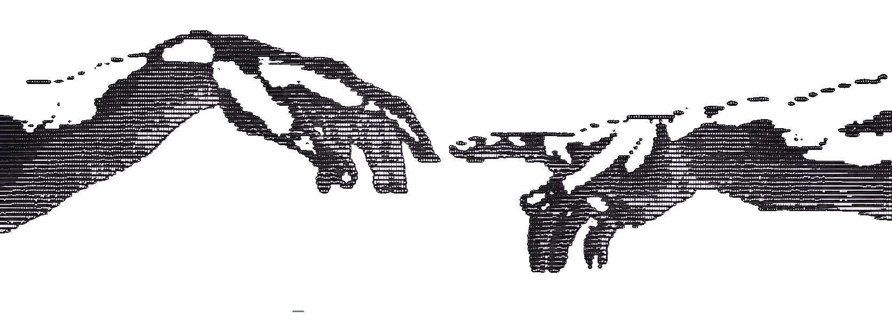

  

<h1 align="center">Pietro Ramos</h1>

  Estudante de Informática • Java & Back-end

  
  

---

## Sobre mim

Estudante do **Ensino Médio Técnico em Informática**, com foco em **Java e desenvolvimento Back-end**.

Tenho interesse em construir software do zero, compreendendo sua lógica, arquitetura e organização. Atualmente, desenvolvo projetos práticos enquanto aprofundo meus conhecimentos em programação.

---

## Tecnologias e ferramentas

  
  
  
  
  
  

---

## Projetos

### ☕ Java10X

Registro da minha evolução em **Java**, reunindo exercícios, desafios e projetos práticos voltados à lógica de programação e orientação a objetos.

  

### 🚀 OdisseIA

Projeto web interativo sobre a **evolução dos jogos eletrônicos e da inteligência artificial**, desenvolvido para a Feira de Ciências 2026.

  

